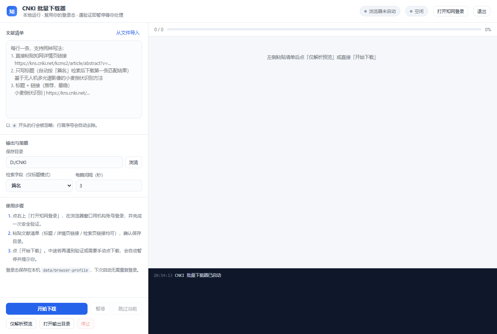

# CNKI 批量下载器

一个跑在**本机**的知网（CNKI）文献批量下载工具。它复用你自己的浏览器登录态和机构权限，逐篇点「PDF下载」并归档，遇到安全验证会自动暂停、把浏览器交还给你处理。



## 它做什么

- 读一份清单（标题 / 标题+链接 / 检索结果页链接），逐篇打开知网详情页下载 PDF
- 下载完成后按 `序号_标题.pdf` 归档到指定目录
- 单篇失败不影响后续：自动跳过，失败原因写进列表和日志
- 每篇之间默认停 3 秒，可调

## 它不做什么

- **不破解验证码**：滑块/点选验证一律暂停，等你在浏览器里手动完成
- **不绕过付费墙**：只使用你账号本身的机构权限，拿不到就如实报失败
- **不伪造机构 IP、不并发轰炸**：单线程串行，请求间隔可配

## 环境要求

- Windows 10 / 11
- Python 3.9+
- 一个有知网下载权限的账号（学校 / 科研院所，通常需在校园网或机构 VPN 内）

## 安装

```bat
git clone https://github.com/Tangmastrain/cnki-downloader.git
cd cnki-downloader
python -m venv .venv
.venv\Scripts\activate
pip install -r requirements.txt
playwright install chromium
```

> `playwright install chromium` 首次会下载约 150 MB 的浏览器内核。
> 若所在网络下载 Chromium 很慢，可改用系统已装的 Edge：在 `cnki_engine.py` 的
> `launch_persistent_context` 里把 `channel` 改成 `"msedge"`。

## 启动

双击 **`启动CNKI下载器.bat`**。它会静默拉起本地服务（`127.0.0.1:8765`），再用 Edge 的应用模式开一个独立窗口。

也可以手动启动：

```bat
python app.py
```

然后浏览器访问 <http://127.0.0.1:8765>。

服务卡死时运行 **`停止服务.bat`**（按端口 8765 找到进程并结束）。

### 解释器是怎么找到的

`启动CNKI下载器.bat` 按以下顺序选择 Python，第一个存在者生效：

1. 环境变量 `CNKI_PYTHON`（完整路径）
2. 项目根目录的 `python_path.txt`（首行写完整路径，适合不想改环境变量的情况）
3. 项目内 `.venv\Scripts\pythonw.exe`（即上面安装步骤的产物）
4. `PATH` 上的 `pythonw` / `python`

## 使用三步

1. **登录**：点右上角「打开知网登录」，在弹出的浏览器窗口里用机构账号登录，完成一次安全验证。验证通过后关掉该标签页即可 —— 登录态保存在 `data/browser-profile/`，下次不用重复登录。
2. **贴清单**：左侧文本框每行一条，支持三种写法（可混用）：

   ```text
   # 1) 只给标题 —— 按「篇名」检索，取相似度最高的一条
   基于无人机多光谱影像的小麦倒伏识别方法

   # 2) 标题 + 详情页链接（最稳，推荐）
   小麦倒伏识别 | https://kns.cnki.net/kcms2/article/abstract?v=...

   # 3) 直接贴检索结果页链接 —— 取第一条
   https://kns.cnki.net/kns8s/defaultresult/index?kw=%E5%B0%8F%E9%BA%A6&korder=TI
   ```

   也可以点「从文件导入」直接读 `.md` / `.txt` / `.html` 清单，程序会自己把里面的知网链接和标题抽出来。
3. **开始下载**：确认保存目录后点「开始下载」。

## 文件命名

默认格式是 `{序号:02d}_{标题}.pdf`。想让文件名带上第一作者，就把条目标题写成 `第一作者_标题`，检索词单独给 —— 通过 REST 提交时，`title` 只用于命名，`query` 用于检索：

```json
{ "seq": 1, "title": "张三_无人机多光谱小麦倒伏", "query": "无人机多光谱小麦倒伏", "order": "篇名" }
```

落盘结果：`01_张三_无人机多光谱小麦倒伏.pdf`。

## 通过 REST 驱动（可选）

界面只是这层 HTTP 接口的壳，脚本化调用很方便：

| 方法 | 路径 | 说明 |
|---|---|---|
| GET | `/api/state` | 当前任务状态、条目列表、实时日志 |
| POST | `/api/start` | 提交任务 `{items, outdir, order, delay}` |
| POST | `/api/stop` | 停止（当前篇结束后生效） |
| POST | `/api/pause` · `/api/resume` | 暂停 / 继续 |
| POST | `/api/skip` | 跳过当前篇（仅在「等待你操作」时有效） |
| POST | `/api/parse` | 解析清单文本 `{text}` |
| POST | `/api/import` | 导入清单文件 `{path}` |

`items` 的每个元素：

```json
{
  "seq": 1,                  // 文件序号，决定 01_ 前缀
  "title": "张三_论文标题",    // 用于生成文件名
  "query": "论文标题",         // 用于篇名检索（留空则用 title）
  "url": "",                 // 知网详情页链接；给了就跳过检索
  "order": "篇名"             // 主题 / 篇名 / 关键词 / 作者 / 摘要
}
```

## 每篇的下载路径（按顺序尝试）

1. 打开详情页 → 依次尝试 `#pdfDown`、`PDF下载` 文本按钮、`dflag=pdfdown` 链接等 12 种选择器
2. 点击后监听下载事件；若新开标签页是 PDF，则用带 Cookie 的请求直接抓取
3. 全页面兜底：扫所有可见 `a` / `button`，文字含 `PDF` 就点
4. 以上都失败 → **人工接管**：提示你在浏览器里手动点一次下载，点完它会自动捕获文件并按规范命名归档

## 常见问题

**提示「未找到匹配文献」或下错了篇目**
篇名检索靠字符串相似度匹配。标题里带连字符、上下标、特殊符号（例如 `Sentinel-2`）时容易命中错篇。
最稳的做法是先在知网搜到该文、复制地址栏链接，按「标题 | 链接」的格式贴进清单。

**一直停在「等待你操作」**
浏览器窗口里出现了滑块/点选验证，或跳到了登录页。手动完成即可；若窗口被最小化，从任务栏点开它。

**失败：下载内容不是有效 PDF**
说明当前机构权限不覆盖该刊，或该文需要付费/登录。程序不会绕过任何付费墙，这类文献请先在浏览器里确认权限后重试。

**失败：浏览器启动失败 / 已在运行的浏览器会话中打开**
多为上一次的浏览器进程没退干净，占着 `data/browser-profile`。运行 `停止服务.bat`，必要时用任务管理器结束残留的 `chrome.exe`（注意只结束带 `--user-data-dir=...\cnki-downloader\browser-profile` 参数的那些），再重试。

**批量任务跑到第二批就全部失败，日志写 `Playwright connection closed`**
Playwright 的同步驱动与创建它的线程绑定，而每次任务都跑在新线程里。本项目已在 `app.py` 的 `worker()` 入口强制重建引擎，若你自行改造过这段代码，注意别复用跨线程的 `Engine` 实例。

**知网改版导致按钮点不到**
`cnki_engine.py` 顶部的 `PDF_SELECTORS` 就是选择器清单，F12 看到新按钮的 id/class 后加一行即可，不用动其它逻辑。

## 目录结构

```text
cnki-downloader/
├─ 启动CNKI下载器.bat   ← 主入口
├─ 停止服务.bat         ← 服务卡死时用
├─ app.py               ← 本地 HTTP 服务 + 任务调度
├─ cnki_engine.py       ← Playwright 下载引擎
├─ web/index.html       ← 界面（单文件，无构建）
├─ _make_bats.py        ← 生成 GBK 编码的 .bat（改动启动逻辑后重跑）
└─ data/                ← 配置 / 日志 / 浏览器配置目录（登录态存这里，已 gitignore）
```

## 合规与免责

本项目只做一件事：**用你自己的账号，把你有权限下载的文献批量点下来**。

- 不破解验证码、不绕过付费墙、不伪造机构 IP、不并发请求
- 下载的文献请遵守知网使用协议，仅用于个人学习与研究
- 请自行确认所在机构的使用条款；因使用本工具产生的任何后果由使用者承担

## License

[MIT](LICENSE)
